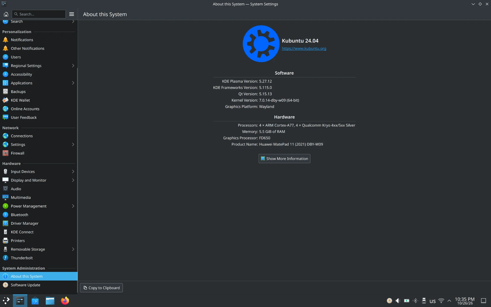

# Kubuntu for the Huawei MatePad 11 (DBY-W09)

Stock Kubuntu 24.04 LTS (Plasma 5.27) for the Huawei MatePad 11 (DBY-W09,
Snapdragon 865), running from the microSD card on mainline Linux 7.0. This
repository builds the image and holds the hardware support services.



| Repository | Role |
| --- | --- |
| [linux-dby-w09](https://github.com/svesnav/linux-dby-w09) | kernel, device tree, boot bundle |
| **kubuntu-dby-w09** (this one) | Kubuntu image builder, hardware services |
| [dby-w09-installer](https://github.com/svesnav/dby-w09-installer) | HarmonyOS app: installs to the microSD card, boots Linux |

## Installing

1. HarmonyOS with root (APatch or Magisk) and a microSD card (32 GB or more; the
   whole card is erased).
2. Install the **MatePad Linux installer** app, choose a release (or a local
   `.img.xz`) and the card, fill in the account, language, keyboard and time
   zone, then **Install**. The app writes the image, grows it to the whole
   card, copies the tablet's own firmware, vendor files and M-Pencil address
   into it, sets up the account, and keeps the stock boot images for the way
   back.
3. **Boot Linux** in the app. The first boot opens the login screen (or the
   desktop, with automatic login).
   To pair the M-Pencil, take it off its magnet and put it back.
4. Back to HarmonyOS: **Restart to HarmonyOS** in the Kubuntu menu or on the
   desktop. HarmonyOS and its data on the internal storage are never touched.

## What the image contains

- `kubuntu-desktop` with Firefox from Mozilla's APT repository (no snaps; the
  default browser),
  Xournal++, the Maliit on-screen keyboard, `ddcutil`/`ddcui`, the Camera app
  (libcamera 0.7.2).
- Plasma on Wayland, SDDM on Wayland, KWin with the OpenGL compositor and the
  blur effect off (popups slide in without a frame of outline).
- Kernel modules from the linux-dby-w09 release.
- The services below, enabled.

It contains **no Huawei files**. `device-files/manifest.txt` and
`device-files/firmware.txt` list what the installer copies from the tablet;
`matepad-device-setup` turns them into the sensor tree, speaker amplifier
tables and Wi-Fi MAC on the first boot.

## Hardware services

| Folder | Function |
| --- | --- |
| `touch/` | runs Huawei's `aptouch_daemon` (from the tablet) through binderfs for the touchscreen and pen position |
| `sensors/` | auto-rotation: patched `hexagonrpcd` serving the SLPI, `matepad-sensord` (accelerometer → `net.hadess.SensorProxy`), rotation toggle |
| `sound/` | TFA9874 speaker amplifiers, ALSA UCM profile, PipeWire EQ and limiter, real-time limits, orientation-aware volume keys |
| `bluetooth/` | BlueZ rebuilt with the HOG CCC-read fix (Huawei keyboard) |
| `pen/` | M-Pencil: pairing by the address from HarmonyOS (it does not advertise as discoverable), pressure and buttons over BLE (GATT helper, hidraw rule) |
| `usb/` | HDMI/DP audio, DisplayPort EDID recovery, DDC/CI access for `ddcutil`, docked rotation |
| `power/` | charging LED (red charging, green full) |
| `camera/` | **Camera** app for both cameras (viewfinder turned with the panel, rear contrast autofocus on the DW9714 lens, tap to focus, photos to `~/Pictures/Camera`, torch), libcamera 0.7.2 with gain models for the OV13B10/Hi-846, camera device access for the user |
| `flashlight/` | **Flashlight** in the menu: the rear flash LED as a torch (`matepad-flashlight`, udev rule for the user) |
| `sleep/` | Sleep button suspends; cover and power key blank the screen; suspend hook and PowerDevil profile |
| `desktop/` | tray relayout after resume, plasmashell guard, on-screen keyboard switching, patched Qt Wayland client (`qt/`) |
| `boot-switch/` | **Restart to HarmonyOS**: saves the Linux boot images to `/cache/linux70`, writes the verified stock ones, reboots |

`image/chroot-setup.sh` builds and installs all of them into the image.

## M-Pencil

The pen advertises without the Bluetooth "discoverable" flag, so Plasma's
**Add Device** never lists it. The installer copies the address of the pen
paired in HarmonyOS to `/etc/matepad/pen-mac`, and `matepad-pen-pair.service`
pairs it once: it scans for that address, pairs (Just Works), trusts and
connects the pen, then exits. The pen advertises when it is woken: take it off
its magnet and put it back. After that `matepad-pen-bluez` handles pressure,
the panel parameters and double-tap (eraser / pen in Xournal++).

Without an address from HarmonyOS (pen never paired there), set it by hand.
`sudo btmgmt find -l` lists the pen as `M-Pencil` while it is awake:

```bash
echo 70:61:EE:00:00:00 | sudo tee /etc/matepad/pen-mac
sudo systemctl restart matepad-pen-pair
journalctl -u matepad-pen-pair -f
```

To pair again, remove the pen in Bluetooth settings and restart
`matepad-pen-pair`.

## Building the image

On Ubuntu 24.04, x86-64 (with `qemu-user-static`) or arm64:

```bash
sudo apt-get install debootstrap qemu-user-static binfmt-support xz-utils e2fsprogs
gh release download -R svesnav/linux-dby-w09 -p 'linux-boot-*.tar'
sudo image/build-image.sh --kernel linux-boot-*.tar --out out
```

Output in `out/`: `kubuntu-dby-w09-<date>.img.xz` (ext4, xz -9, label `LINUX70ROOT`,
2 GiB of free space for the device files; the first boot grows it to the card), its `.sha256`, the package list
and the uncompressed size. Downloaded packages are cached in
`/var/tmp/matepad-image/apt-archives` between builds.

`--dev-key ~/.ssh/id_ed25519.pub` makes a development build with an SSH
server for root and a root console on the USB serial port. Never publish one.

## CI

`.github/workflows/image.yml` (manual run or a `v*` tag):

1. downloads the kernel bundle from the latest linux-dby-w09 release (or the
   one given), checking its `SHA256SUMS`;
2. builds the image (native arm64 runner for public repositories, qemu on
   x86-64 otherwise);
3. `image/release-manifest.py` splits images over 1.9 GiB into `.partNN`
   assets and writes `<name>.json`, which the installer reads;
4. publishes the image, manifest, checksums, package list and the kernel
   bundle as one release.

While linux-dby-w09 is private, the workflow needs a repository secret
`KERNEL_REPO_TOKEN` that can read it.

The kernel and image builds can run on your own Linux server instead:
`ci/runner/` has a Docker Compose setup for self-hosted runners, selected
with the repository variable `RUNNER` (see `ci/runner/README.md`).

## Repository layout

| Path | Contents |
| --- | --- |
| `image/` | `build-image.sh`, `chroot-setup.sh`, first-boot `matepad-device-setup`, release manifest and notes |
| `device-files/` | lists of the tablet files the installer copies |
| `ci/runner/` | self-hosted GitHub Actions runners (Docker Compose) for the kernel and image builds |
| `touch/` … `boot-switch/` | hardware services (above) |
